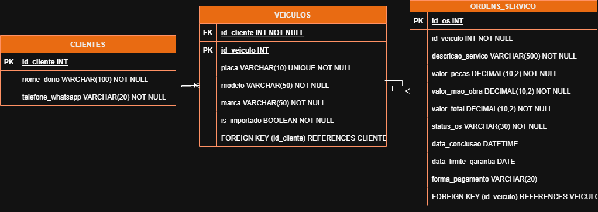

# Seu Osvaldo — Oficina Mecânica  Cliente: Seu Osvaldo (Oficina Mecânica).  
Objetivo: Gerenciar Ordens de Serviço (OS) de forma ágil, com cálculo automático de orçamentos, aplicação de taxas para veículos importados, emissão de recibos com garantia de 90 dias via WhatsApp e consulta de histórico por placa do veículo.  
# Mer
cliente
- id_cliente PK
- nome_dono VARCHAR(150)
- telefone_whatsapp VARCHAR(20)

veiculo
- id_veiculo PK
- id_cliente FK
- placa VARCHAR(10)
- modelo VARCHAR(50)
- marca VARCHAR(50)
- is_importado BOOLEAN

ordem_servico
- id_os PK
- id_veiculo FK
- descricao_servico VARCHAR(500)
- valor_pecas DECIMAL(10,2)
- valor_mao_obra DECIMAL(10,2)
- valor_total DECIMAL(10,2)
- status_os VARCHAR(30)
- data_conclusao DATETIME
- data_limite_garantia DATE
- forma_pagamento VARCHAR(20)

relacionamento
- 1 cliente para varios veiculos
- 1 veiculo para varias ordem_servico

# Der 
